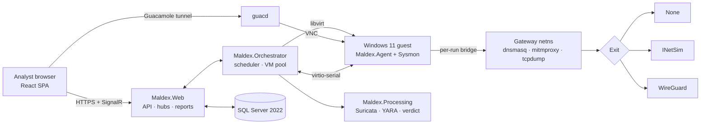

<p align="center">
  <picture>
    <source media="(prefers-color-scheme: light)" srcset="docs/assets/maldex-banner-light.svg">
    
  </picture>
</p>

<p align="center">
  <strong>A self-hosted, interactive malware-analysis sandbox for SOC teams.</strong><br>
  Detonate a file or URL in a throwaway Windows 11 VM, drive the desktop live in your browser,<br>
  and watch the process tree, file, registry, network and DNS activity stream in as it happens.
</p>

<p align="center">
  <a href="LICENSE"></a>
  
  
  <br>
  
  
  
  
  
  
</p>

<p align="center">
  <a href="#features">Features</a> ·
  <a href="#how-it-works">How it works</a> ·
  <a href="#quick-start">Quick start</a> ·
  <a href="#development-progress">Progress</a> ·
  <a href="#contributing">Contributing</a>
</p>

---

> [!WARNING]
> MALdex exists to run hostile code. Treat every host it runs on as dedicated to it. Until a maintainer explicitly signs off, **only the harmless test files in [`deploy/guest/samples`](deploy/guest/samples)** are run against a real VM: EICAR, a registry-write script, a URL we control, and a benign macro that launches `calc.exe`.

## Why MALdex

Hosted sandboxes are fast and polished, but every sample you upload leaves your network. MALdex gives an MSP's SOC the same interactive workflow on infrastructure it controls. We weigh decisions in this order:

1. **Data sovereignty.** Samples, telemetry and results never leave our infrastructure.
2. **Interactive analysis.** Analysts drive the VM live while telemetry streams in.
3. **Workflow integration.** SSO, per-customer org tagging, and later mailbox intake and IOC export.
4. **Cost.**

MALdex is an internal tool, not a commercial product. It is built from a custom .NET control plane on top of open-source components we trust: libvirt/QEMU, Apache Guacamole, mitmproxy, tcpdump, Suricata, YARA, INetSim and Sysmon.

## Features

### Analysis

- **Files and URLs.** Submit Office and PDF documents, PE files, scripts (PowerShell, JS, VBS, HTA, BAT, LNK) and containers, or just a URL.
- **Live, interactive desktop.** A Guacamole stream into the guest, in the browser, with no plugins. Extend the run, upload another file, reboot or stop.
- **Real-time telemetry over SignalR.** A process tree plus file, registry, network and DNS events, pushed to the UI while the sample runs.
- **Full network capture.** A PCAP per run, decrypted HTTP(S) transactions through transparent mitmproxy, and Suricata flow records and alerts.
- **Detections and verdicts.** YARA on the sample and on every dropped file, Suricata alerts, and behavioral heuristics (Office spawning a script host, `Run`/`RunOnce` persistence, executables dropped and then run). These roll up into **Malicious / Suspicious / No threats detected**.
- **Reports.** A single HTML report template, also exported to PDF through headless Chromium. It covers the timeline, process tree, network and HTTP activity, detections and screenshots.
- **Safe artifact downloads.** Samples, dropped files and captures are only ever served as password-protected ZIPs (`infected`).

### Isolation

- **Throwaway VMs.** Each run boots from a copy-on-write overlay of a clean, hardened Windows 11 26H2 image (UEFI + Secure Boot, TPM 2.0). The VM, overlay and network are destroyed when the run ends.
- **No route out by default.** Each run gets its own L2 bridge with no host IP and a private gateway namespace. nftables drops by default, and host-wide guard tables drop any forwarding to or from run interfaces.
- **Network modes.** `None`, `Simulated` (INetSim answers everything), `LiveVpn(country)` through a WireGuard exit, and `LiveTor` (planned).
- **Fails closed.** If the chosen exit is unavailable, the run fails while it is preparing. It never falls back to direct egress.
- **Isolation self-test before every real run.** The guest probes the gateway, the host, the LAN and RFC1918 ranges. Detonation only happens if every internal probe fails and the egress IP matches the expected exit.
- **No guest networking for the agent.** The in-guest agent talks over **virtio-serial** with framed, size-capped, schema-validated, rate-limited messages. Samples go in and dropped files come out as chunked, SHA-256-verified transfers.

### Operations

- **Local accounts by default, optional OIDC SSO.** Built-in users with `Analyst` and `Admin` roles, lockout, optional TOTP and break-glass admins; any OpenID Connect provider (Entra ID, Keycloak, ...) can be added for single sign-on (`DevAuth` in development).
- **Org tagging.** Every task belongs to a customer org, and each org has its own retention window, enforced by a nightly job.
- **Audit log** of submissions, downloads, session joins, deletions and admin changes.
- **Safe rendering.** Guest-derived strings are always shown as text, never as HTML. The SPA and the reports run under a strict CSP.
- **Fake mode.** The whole product, UI included, runs without a VM in about 3–4 GB of RAM, against a replayed agent.

## How it works



Each task moves through a single, audited state machine:

```text
Queued → Preparing → Running → Collecting → Processing → Completed
            │           │          │             │
            └───────────┴──────────┴─────────────┴──→ Failed | Cancelled
```

### Repository layout

| Path | What's there |
| --- | --- |
| `src/Maldex.Core` | Domain model, lifecycle state machine, scheduler and verdict rules, all pure and unit-tested |
| `src/Maldex.Data` | EF Core context, configurations and migrations (SQL Server) |
| `src/Maldex.Infrastructure` | libvirt, networking, Guacamole, the agent channel, storage, scanning, and the dev **fakes** |
| `src/Maldex.Orchestrator` | Runs tasks: prepare, detonate, collect, tear down |
| `src/Maldex.Processing` | Post-run Suricata, YARA, HTTP indexing and verdicts |
| `src/Maldex.Web` | ASP.NET Core host: API endpoints, SignalR hubs, auth, audit, HTML/PDF reports |
| `src/Maldex.Agent` | C# guest agent: collectors, commands, isolation probes, file transfers |
| `ui/` | React + TypeScript (Vite) SPA |
| `tests/` | xUnit unit and integration suites (Testcontainers SQL Server, real-VM E2E behind env gates) |
| `deploy/guest` | Unattended Windows 11 image build and provisioning, plus the harmless E2E samples |
| `deploy/net`, `deploy/host` | INetSim, mitmproxy and Suricata config, and host nftables guard tables |
| `rules/yara` | YARA rules (indexed through `index.yar`) |
| `build.sh` | Every local workflow: setup, run, test, smoke, guest build, E2E |

## Quick start

**Prerequisites:** Ubuntu 24.04, the .NET 10 SDK, Docker, Node 22 and YARA 4.5. Real mode also needs KVM.

```bash
git clone https://github.com/basht0p/Maldex.git
```

```bash
cd Maldex && ./build.sh setup
```

`setup` generates `.env` with a random SQL Server SA password, restores .NET tools and installs Chromium for PDF reports.

### Fake mode (the default: no VM)

```bash
./build.sh run
```

This starts SQL Server in Docker (capped at 2 GB), the backend on `http://localhost:5080` and the Vite dev server. Sign-in uses `DevAuth`, and runs are played back by `FakeHypervisor` + `ReplayAgent`, so you get a live process tree, events, verdicts and reports with no Windows guest.

Template jobs (Build, Edit, Refresh) also run in fake mode, but they load the same components as real mode: the guest agent (`./build.sh agent`) and the mitmproxy CA (`.data/mitm/ca/mitmproxy-ca-cert.pem`), and a Build also needs the virtio driver ISO (`.data/vm/iso/virtio-win.iso`). Run `./build.sh real-setup` once, or place stubs: any PEM certificate as the CA and an empty file as the virtio ISO (fake mode never reads it):

```bash
mkdir -p .data/mitm/ca .data/vm/iso
openssl req -x509 -newkey rsa:2048 -nodes -subj /CN=maldex-dev-ca -keyout /dev/null -out .data/mitm/ca/mitmproxy-ca-cert.pem
touch .data/vm/iso/virtio-win.iso
```

### Real mode (one Windows 11 VM)

```bash
./build.sh real-setup
```

```bash
MALDEX_MODE=Real ./build.sh run
```

`real-setup` installs libvirt/QEMU, OVMF, swtpm, WireGuard tools, a pinned mitmproxy, Suricata, INetSim and the tools the template Build needs (`wimtools`, `xorriso`, libguestfs), and caches the virtio drivers and `Sysmon.zip`. In real mode, `run` also starts guacd in Docker for the live view. Then build the guest image in the app: upload or fetch a Windows 11 ISO under **Admin → Sandbox Templates → Media**, start **New template**, turn off Tamper Protection and Defender in the job's console, and press **Seal**. See [`deploy/guest/README.md`](deploy/guest/README.md) for the Build flow, media options and Office. A real run budgets about 9 GB of RAM in total (4 GB / 2 vCPU for the guest).

### `build.sh` targets

| Target | What it does |
| --- | --- |
| `setup` | Generate `.env`, restore tools, install Chromium for PDF |
| `dev-db` | Start SQL Server 2022 in Docker on `localhost:14333` |
| `run` | Dev backend + Vite (`MALDEX_MODE=Real` for real mode) |
| `test` | All .NET tests and the UI unit tests |
| `smoke` | Playwright E2E against the hosted SPA and the fake backend |
| `build` | Build the SPA into `wwwroot` and publish `Maldex.Web` |
| `real-setup` / `real-smoke` | Install the real-mode toolchain / boot a throwaway KVM VM to check it |
| `agent` | Publish the guest agent that templates are built and refreshed with |
| `e2e` | Harmless real-VM end-to-end suite (needs the default template `win11-26h2`) |
| `e2e-templates` | Real template-job E2E (Refresh, Edit, Roll back, Build from `MALDEX_WIN_ISO`); a green full run writes the validation stamp |
| `e2e-build-acceptance` | Interactive Build from `MALDEX_WIN_ISO`: you turn off Defender in the job's console (localhost:5080 over an SSH forward) and press Seal |

## Install on a server

Release packages are built and signed by the release workflow: a `.deb` for Ubuntu 24.04 and an `.rpm` for RHEL 9 and its rebuilds (x86_64). Maldex assumes a **dedicated host**: the package creates five system users (`maldex`, `maldex-mitm`, `maldex-dns`, `maldex-isroot`, `maldex-isuser`) and a sudoers file that gives the `maldex` service user passwordless `sudo` for a fixed list of commands (`chmod chown cp find install ip iptables kill mount nft rm setsid sysctl umount`), because the app drives libvirt, nftables and network namespaces through `sudo -n`. Do not install it on a shared machine.

1. **Download and verify.** Download the `.deb` or `.rpm`, `SHA256SUMS`, `SHA256SUMS.asc` and `maldex-signing-key.asc` from the GitHub release, then:

   ```bash
   gpg --show-keys --with-fingerprint maldex-signing-key.asc
   gpg --import maldex-signing-key.asc
   gpg --verify SHA256SUMS.asc SHA256SUMS
   sha256sum -c SHA256SUMS --ignore-missing
   ```

   The checksums and signatures only prove the files match the key you imported, so compare the fingerprint printed by `--show-keys` with one you obtained out of band (ask basht0p) before trusting the key. Do not take the fingerprint from the same release page.

2. **Install.**

   ```bash
   sudo apt install ./maldex_*.deb
   ```

   On RHEL, first `sudo dnf install epel-release` and enable the CRB repository (`sudo dnf config-manager --set-enabled crb`), then `sudo dnf install ./maldex-*.rpm`. For the rpm you can also `sudo rpm --import maldex-signing-key.asc` and check it with `rpm -K maldex-*.rpm`.

   **RHEL: install INetSim by hand.** EL9 has no INetSim package (not in the base repositories, not in EPEL), so the rpm cannot depend on it. Install it from the [INetSim release tarball](https://www.inetsim.org/downloads.html) and its Perl dependencies so that `/usr/bin/inetsim` and its data directory `/var/lib/inetsim` exist, then create its system user: `sudo useradd --system --user-group --no-create-home --shell /usr/sbin/nologin inetsim`. `maldex-setup` checks all three. The rpm also links `/usr/bin/qemu-system-x86_64` to RHEL's `/usr/libexec/qemu-kvm`, the emulator path the VMs use.

3. **Configure the database.** Edit `/etc/maldex/appsettings.Production.json` (mode 0640, `root:maldex`) and set the SQL Server connection string. Nothing else is required: sign-in uses local accounts, and single sign-on is optional (see [Single sign-on](#single-sign-on-optional)). No SQL Server yet? See [SQL Server Express on the same host](#sql-server-express-on-the-same-host).

4. **Run the host setup.**

   ```bash
   sudo maldex-setup
   ```

   It installs and checks the rest of the host (libvirt/KVM, mitmproxy, guest tooling, Sysmon and the virtio drivers), then restarts maldex and checks that it stays up; if it does not, `journalctl -u maldex -n 50` names the problem. `maldex-setup --check` re-runs only the read-only checks.

   **First admin.** Right after the database check, setup creates the first Maldex admin if no enabled admin exists yet: it asks for a user name (default `admin`) and then, without echo, for a password (12 to 256 characters). Run it from a terminal for this. Without one the step fails and prints the command to run yourself: `sudo maldex-admin create-user <name> --admin`. Re-running setup later does nothing here once an enabled admin exists, and `maldex-setup --check` fails while there is none.

   **Offline.** On a host without internet access, copy `Sysmon.zip` and `virtio-win.iso` into a directory and run `sudo maldex-setup --offline <dir>`. Offline mode does not cover the OS packages (use a local mirror) or the Playwright Chromium that PDF reports need. To include Chromium, install it on a connected host with the same Maldex version (`PLAYWRIGHT_BROWSERS_PATH=$PWD/ms-playwright /opt/maldex/app/Maldex.Web --install-browsers --no-deps`) and copy that `ms-playwright` directory to `<dir>/ms-playwright`; maldex-setup copies it to `/var/lib/maldex/ms-playwright`. Without it, setup warns, finishes, and everything except PDF reports works; add Chromium later with `sudo maldex-setup` once the host can reach the Playwright CDN.

5. **Sign in.** The app listens on `http://127.0.0.1:5080` only; reach it through an SSH forward (`ssh -L 5080:127.0.0.1:5080 <host>`, then open `http://127.0.0.1:5080`) or a reverse proxy you provide, and sign in with the admin from step 4. Create analyst accounts under **Admin → Users** (or with `maldex-admin`, see below), then build the first guest image under **Admin → Sandbox Templates → New template**.

   **Behind a TLS reverse proxy,** the proxy runs on the same host, forwards to `127.0.0.1:5080` and must set `X-Forwarded-Proto`, `X-Forwarded-Host` and `X-Forwarded-For`. Maldex honours these headers only from a loopback client. They decide the cookie's `Secure` flag and the single sign-on redirect URI, so without them HTTPS sign-in and SSO break. SSO needs an HTTPS origin unless you use the SSH forward (`http://127.0.0.1` counts as a secure context in browsers; any other plain-HTTP address is not supported).

Restarting or upgrading the maldex package, restarting `maldex-host-guard`, or re-running `maldex-setup` (which restarts maldex) stops any running analysis VMs; let runs finish first.

### Single sign-on (optional)

Local accounts work with no identity provider. To also let people sign in with a standard **OpenID Connect** provider (Entra ID, Keycloak, Okta, ...), set `Maldex:Auth:Oidc` in `/etc/maldex/appsettings.Production.json` and run `sudo systemctl restart maldex`. SAML is not supported.

Register Maldex at the provider as a web application with the redirect (callback) URI **`<origin>/signin-oidc`**, where `<origin>` is the URL people open, for example `https://maldex.example.com/signin-oidc`. Behind a reverse proxy, see the forwarded-header note in step 5 above: the redirect URI Maldex sends is built from `X-Forwarded-Proto` and `X-Forwarded-Host`. Maldex uses the authorization code flow with PKCE.

| Key (under `Maldex:Auth`) | Meaning |
| --- | --- |
| `PasswordLogin` | `true` (default) keeps the password form for everyone. `false` turns password sign-in off except for break-glass local admins (below). It needs `Oidc.Enabled=true`, or Maldex refuses to start. |
| `Oidc.Enabled` | `true` switches SSO on. Startup then checks the other keys and exits with status 78 and a message if they are wrong. |
| `Oidc.DisplayName` | The label on the sign-in button ("Sign in with Company SSO"). |
| `Oidc.Authority` | The issuer URL. It must be `https://` and serve `/.well-known/openid-configuration`. |
| `Oidc.ClientId` / `Oidc.ClientSecret` | The registration's client. The secret is optional: without one Maldex acts as a public client (PKCE only), for providers that allow it. The secret sits in the same `0640 root:maldex` file as the database password. |
| `Oidc.Scopes` | Default `openid profile email`. Add the scope your provider needs to release the role or group claim. |
| `Oidc.NameClaim` | Claim for the display name, default `name` (falls back to `preferred_username`, then `email`, then `sub`). |
| `Oidc.RoleClaim`, `AdminValues`, `AnalystValues` | The role mapping, below. |

**Who is who.** An SSO user is identified by the provider's issuer and `sub` claim, never by e-mail or user name, so an SSO sign-in never takes over a local account with the same name. Changing `Authority` therefore creates new users instead of re-binding the old ones.

**Roles.**

- *With a mapping* (`RoleClaim` set): the provider decides at every sign-in. All values of that claim are read; the user is **Admin** if any value is in `AdminValues`, else **Analyst** if any is in `AnalystValues`, else the sign-in is refused ("your account has no Maldex role") and audited. `AdminValues` must not be empty. Values are compared **exactly: case-sensitive**, after trimming spaces. Roles of SSO users are then managed by the provider and cannot be changed in Maldex.
- *Without a mapping* (`RoleClaim` empty): a new SSO user starts with **no access** and sees a "waiting for an administrator" page until an admin grants a role under **Admin → Users** (or `maldex-admin set-role`). Existing users keep their role.

**Break-glass admins.** With `PasswordLogin=false` an identity-provider outage would lock everyone out. A **break-glass** account is a local Admin that may still use a password (and must use TOTP) while password login is off. Create one with `sudo maldex-admin create-user <name> --admin --break-glass`, or mark an existing local admin with `sudo maldex-admin set-break-glass <name> on`. The password form stays reachable at `/login?local=1` for these accounts. `maldex-setup --check` warns when password login is off, SSO is on and no break-glass admin exists, and `maldex-setup` creates the first admin as break-glass when password login is off.

**Entra ID example.**

1. In the Entra admin center, **App registrations → New registration**. Choose a single tenant, platform **Web**, and the redirect URI `https://maldex.example.com/signin-oidc`.
2. **Certificates & secrets → New client secret**; copy the secret value.
3. **App roles → Create app role** twice: display name *Maldex Admin*, value `Maldex.Admin`, allowed member types *Users/Groups*; and *Maldex Analyst* with value `Maldex.Analyst`.
4. In **Enterprise applications** for the same app, **Users and groups**, assign people or groups to the roles. (Turn on *Assignment required* to keep everyone else out.)
5. Configure Maldex:

   ```jsonc
   "Maldex": { "Auth": {
     "Oidc": {
       "Enabled": true,
       "DisplayName": "Contoso",
       "Authority": "https://login.microsoftonline.com/<tenant-id>/v2.0",
       "ClientId": "<application (client) id>",
       "ClientSecret": "<secret value>",
       "RoleClaim": "roles",
       "AdminValues": ["Maldex.Admin"],
       "AnalystValues": ["Maldex.Analyst"]
     }
   }}
   ```

**Keycloak example.**

1. In the realm, **Clients → Create client**: client type *OpenID Connect*, a client ID such as `maldex`, **Client authentication on** (a confidential client), the standard flow only, and the valid redirect URI `https://maldex.example.com/signin-oidc`. Copy the secret from the **Credentials** tab.
2. **Client scopes → maldex-dedicated → Add mapper → By configuration → Group Membership**: token claim name `groups`, **Full group path off**, add to ID token on.
3. Create the groups (for example `maldex-admins`, `maldex-analysts`) and add the users.
4. Configure Maldex:

   ```jsonc
   "Maldex": { "Auth": {
     "Oidc": {
       "Enabled": true,
       "DisplayName": "Keycloak",
       "Authority": "https://keycloak.example.com/realms/<realm>",
       "ClientId": "maldex",
       "ClientSecret": "<client secret>",
       "RoleClaim": "groups",
       "AdminValues": ["maldex-admins"],
       "AnalystValues": ["maldex-analysts"]
     }
   }}
   ```

### Managing users from the command line

Accounts are managed in the app under **Admin → Users** (create users, reset passwords, change roles, disable, clear TOTP, mark break-glass, and the *Require TOTP for local accounts* switch). `maldex-admin` does the same from the host and works when nobody can sign in. It must run as root, runs the app as the `maldex` user against the configured database, and never takes a password as an argument: you are asked twice without echo, or you pipe it in with `--password-stdin` (one line on stdin).

```bash
sudo maldex-admin list [--json]
sudo maldex-admin create-user <name> [--admin|--analyst] [--display-name <text>] [--break-glass] [--password-stdin]
sudo maldex-admin reset-password <name> [--reset-totp] [--password-stdin]
sudo maldex-admin set-break-glass <name> on|off
sudo maldex-admin disable <name>        # and: enable <name>
sudo maldex-admin set-role <name> admin|analyst|none
```

- `create-user` makes a local user (analyst unless `--admin`); users created here do **not** have to change their password at first sign-in. Names are 1 to 64 characters of letters, digits and `. _ @ -`; passwords are 12 to 256 characters.
- `list` shows name, kind (local or SSO), role, disabled, TOTP, break-glass and last sign-in; `--json` is for scripts.
- Changes that would leave no enabled admin able to sign in are refused (exit status 1), and so is changing the role of an SSO user while a role mapping is configured. Other exit codes: 64 for a usage error, 78 for a configuration or database error. Every change is written to the audit log as user `cli`.

**Recovering a locked-out admin.** Five wrong passwords lock an account for 15 minutes. To get back in right away, or after losing the password or the authenticator, run `sudo maldex-admin reset-password <name> --reset-totp` (leave out `--reset-totp` to keep the authenticator). It sets the new password, clears the lockout and ends the user's open sessions within five minutes. If every admin is gone, create a new one with `sudo maldex-admin create-user <name> --admin`.

### SQL Server Express on the same host

Maldex needs a SQL Server database. If your organization already runs SQL Server, ask for an empty database and a login that owns it, and skip this section. Otherwise you can run the free **SQL Server 2025 Express** edition on the Maldex host itself. Express is limited to 50 GB per database, 4 cores and about 1.4 GB of buffer memory, which is enough for one Maldex host with retention enabled. Maldex creates its tables itself on first start, so you only need an empty database and a login.

Run these steps before step 3 above.

1. **Add Microsoft's repositories and install SQL Server and `sqlcmd`.**

   On Ubuntu 24.04:

   ```bash
   curl -fsSL https://packages.microsoft.com/keys/microsoft.asc | sudo gpg --batch --yes --dearmor -o /usr/share/keyrings/microsoft-prod.gpg
   curl -fsSL https://packages.microsoft.com/config/ubuntu/24.04/mssql-server-2025.list | sudo tee /etc/apt/sources.list.d/mssql-server-2025.list
   curl -fsSL https://packages.microsoft.com/config/ubuntu/24.04/prod.list | sudo tee /etc/apt/sources.list.d/mssql-release.list
   sudo apt-get update
   sudo apt-get install -y mssql-server
   sudo ACCEPT_EULA=Y apt-get install -y mssql-tools18 unixodbc-dev
   ```

   On RHEL 9:

   ```bash
   curl -fsSL https://packages.microsoft.com/config/rhel/9/mssql-server-2025.repo | sudo tee /etc/yum.repos.d/mssql-server-2025.repo
   curl -fsSL https://packages.microsoft.com/config/rhel/9/prod.repo | sudo tee /etc/yum.repos.d/mssql-release.repo
   sudo dnf install -y mssql-server
   sudo ACCEPT_EULA=Y dnf install -y mssql-tools18 unixODBC-devel
   ```

   With SELinux enforcing, you can also `sudo dnf install -y mssql-server-selinux` to run SQL Server confined.

2. **Configure SQL Server as Express.** Generate an `sa` password, run the setup without prompts, then limit SQL Server to loopback and cap its memory. By default SQL Server takes 80% of the host's RAM, which the analysis VMs need.

   ```bash
   SA_PW="$(openssl rand -base64 24 | tr -d '/+=')Aa1"
   sudo MSSQL_PID=Express ACCEPT_EULA=Y MSSQL_SA_PASSWORD="$SA_PW" /opt/mssql/bin/mssql-conf -n setup
   sudo /opt/mssql/bin/mssql-conf set network.ipaddress 127.0.0.1
   sudo /opt/mssql/bin/mssql-conf set memory.memorylimitmb 2048
   sudo systemctl restart mssql-server
   systemctl is-active mssql-server
   ```

   Keep `$SA_PW` in your password manager; it is the only administrator login.

3. **Create the database and the Maldex login.** The login owns only the `maldex` database. Both passwords reach `sqlcmd` through the environment, so they don't appear in the process list.

   ```bash
   DB_PW="$(openssl rand -base64 24 | tr -d '/+=')Aa1"
   SQLCMDPASSWORD="$SA_PW" MALDEX_DB_PW="$DB_PW" /opt/mssql-tools18/bin/sqlcmd -S 127.0.0.1 -U sa -C -b <<'SQL'
   CREATE DATABASE maldex;
   GO
   CREATE LOGIN maldex WITH PASSWORD = '$(MALDEX_DB_PW)', DEFAULT_DATABASE = maldex;
   GO
   USE maldex;
   CREATE USER maldex FOR LOGIN maldex;
   ALTER ROLE db_owner ADD MEMBER maldex;
   GO
   SQL
   ```

4. **Print the connection string** and paste it into `ConnectionStrings:Maldex` in `/etc/maldex/appsettings.Production.json` (step 3 above). Then clear the variables.

   ```bash
   echo "Server=127.0.0.1,1433;Database=maldex;User Id=maldex;Password=$DB_PW;TrustServerCertificate=True"
   unset SA_PW DB_PW
   ```

   `TrustServerCertificate=True` is needed because SQL Server uses a self-signed certificate. The generated passwords contain no `;` or quotes, which would break the connection string. `sudo maldex-setup` then checks that it can reach the database.

SQL Server listens on 127.0.0.1 only, so you don't need to open a firewall port. Back up the database with your usual tooling (`BACKUP DATABASE maldex TO DISK = ...` through `sqlcmd`). Express has no SQL Server Agent jobs to schedule this, so use a cron job or systemd timer.

## Development progress

MALdex is delivered in sub-projects. **Sub-project 1, the core detonation slice, is code complete** and runs green end to end on a real Windows 11 guest.

| Milestone | Status |
| --- | --- |
| Design spec for the core detonation slice | ✅ Approved |
| **Plan 1a:** fake-mode slice (submit → live tree → verdict → HTML/PDF report → ZIP downloads → retention) | ✅ Complete |
| **Plan 1b:** real mode (libvirt, guest image, per-run networking, capture, isolation self-test, live view) | ✅ Merged (#3, #4, #5) |
| Pre-live hardening (capability-free dnsmasq, per-run PID namespace for INetSim) | ✅ Merged (#6) |
| First real-VM E2E on Windows 11 (EICAR, registry write, URL) | ✅ Green (#7) |
| Brand identity: Magic Bytes mark, icons, design tokens | 🟦 In review (#2) |
| Containerized deployment with one-command install | 🟦 In review (#1) |
| Office in the guest image (benign calc-macro scenario) | ⬜ Planned |
| Edge first-run suppression for URL runs | ⬜ Planned |
| Per-run uids for dnsmasq/mitmdump, then more than one concurrent VM | ⬜ Planned |
| First live-malware detonation | 🔒 Needs maintainer sign-off |

### Roadmap

- **Next sub-projects:** phishing mailbox intake (Microsoft 365, Graph API) with automated runs. IOC extraction and export (STIX, MISP, SIEM).
- **Later:** Sigma, capa and other static analysis, threat-intel enrichment, Tor and multi-country exits, Linux guests, multiple KVM hosts, memory forensics, CI.
- **Not planned:** Android, or sharing samples or results outside our infrastructure.

**Target scale:** 10–12 concurrent runs and about 100 runs a day at peak, mostly interactive, on a single host.

## Contributing

Contributions from the team are welcome. MALdex handles live malware, so a few rules here are stricter than usual. Please read this whole section before your first PR.

### Ground rules

1. **Never commit malware.** No live samples, no PCAPs from real detonations, no dumps. The only samples in the repo are the harmless files in [`deploy/guest/samples`](deploy/guest/samples). If you need a new test case, make it harmless and describe its expected outcome there.
2. **No live detonations without sign-off.** Real-VM work uses the harmless samples until a maintainer explicitly approves live malware on a given host.
3. **Isolation is not negotiable.** Changes to networking, nftables, the agent channel or the self-test must keep egress failing closed and must never add a route from a guest to the host, the control plane or the LAN. Call these changes out in your PR description.
4. **Guest data is hostile.** Anything that came from the guest (command lines, filenames, URLs, HTTP bodies) is rendered as text, size-capped and validated. Never render it as HTML or execute it on the host.
5. **No secrets in git.** `.env` and anything under `.data/` stay local.

### Workflow

1. **Talk first for anything sizable.** Open an issue describing the problem and your proposed design before writing a lot of code. Features start from a short design note, then a plan, then code.
2. **Branch from `main`.** Use a descriptive name such as `feat/ioc-export` or `fix/agent-frame-cap`.
3. **Test-driven.** Write the failing test first, then make it pass. Pure logic (state machine, scheduler, verdict rules, frame parsing) belongs in `Maldex.Core` with unit tests. Behavior across components gets an integration test against the fakes.
4. **Keep fake mode working.** Every feature has to run with `FakeHypervisor` and `ReplayAgent`. Real-VM tests stay behind the `MALDEX_REAL_VM` / `MALDEX_REAL_NET` gates.
5. **Run the checks locally.** There is no hosted CI on purpose. Before you open a PR, run:

   ```bash
   ./build.sh test
   ```

   ```bash
   ./build.sh smoke
   ```

   If your change touches the hypervisor, the guest, networking or the agent and you have a KVM host, run `./build.sh e2e` too and paste the result into the PR.
6. **Open a PR to `main`.** Say what was true before, what's true after, how you verified it, and anything you deliberately left out. Keep PRs focused, since smaller ones get reviewed faster. A maintainer reviews and merges.

### Conventions

- **Commits** follow [Conventional Commits](https://www.conventionalcommits.org/) with a scope: `feat(processing): …`, `fix(agent): …`, `test(real): …`, `build(deploy): …`. Describe the behavior change, not the edit.
- **C#:** nullable reference types are on and **warnings are errors** (`Directory.Build.props`). Package versions live centrally in `Directory.Packages.props`. Don't pin versions in project files.
- **TypeScript:** Vitest + React Testing Library for components, and `npm --prefix ui run lint` (oxlint) before pushing.
- **Resources:** keep the dev loop light. Fake mode should stay around 3–4 GB of RAM, and real mode runs one VM.
- **UI:** use the Magic Bytes design tokens. Accent blue is only for things a user can act on. Status colors describe analysis state, and severity is never shown by color alone.

### Reporting a security issue

If you find a way for a guest to reach the host, the control plane or the LAN, or any other sandbox escape or isolation gap, **don't open a public issue.** Contact the maintainer (@basht0p) privately, and stop running real VMs on the affected host until it's fixed.

## License

Licensed under the [Apache License 2.0](LICENSE).

## Shamelessly AI Developed Code

MALdex is written almost entirely by AI coding agents. Every design, plan and change is closely overseen by a Security Engineer with years of professional, non-AI software development experience, who reviews and approves everything before it merges.

<p align="center"><sub><code>4D 5A</code> · Built for the SOC, kept on our own metal.</sub></p>
