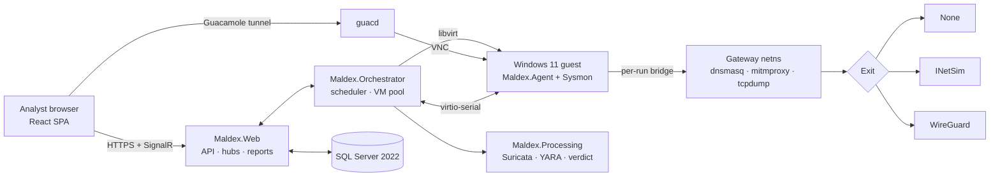

<p align="center">
  <picture>
    <source media="(prefers-color-scheme: light)" srcset="docs/assets/maldex-banner-light.svg">
    
  </picture>
</p>

<p align="center">
  <strong>A self-hosted, interactive malware-analysis sandbox for SOC teams.</strong><br>
  Detonate a file or URL in a throwaway Windows 11 VM, drive the desktop live in your browser,<br>
  and watch the process tree, file, registry, network and DNS activity stream in as it happens.
</p>

<p align="center">
  <a href="LICENSE"></a>
  
  
  <br>
  
  
  
  
  
  
</p>

<p align="center">
  <a href="#features">Features</a> ·
  <a href="#how-it-works">How it works</a> ·
  <a href="#quick-start">Quick start</a> ·
  <a href="#development-progress">Progress</a> ·
  <a href="#contributing">Contributing</a>
</p>

---

> [!WARNING]
> MALdex exists to run hostile code. Treat every host it runs on as dedicated to it. Until a maintainer explicitly signs off, **only the harmless test files in [`deploy/guest/samples`](deploy/guest/samples)** are run against a real VM: EICAR, a registry-write script, a URL we control, and a benign macro that launches `calc.exe`.

## Why MALdex

Hosted sandboxes are fast and polished, but every sample you upload leaves your network. MALdex gives an MSP's SOC the same interactive workflow on infrastructure it controls. We weigh decisions in this order:

1. **Data sovereignty.** Samples, telemetry and results never leave our infrastructure.
2. **Interactive analysis.** Analysts drive the VM live while telemetry streams in.
3. **Workflow integration.** SSO, per-customer org tagging, and later mailbox intake and IOC export.
4. **Cost.**

MALdex is an internal tool, not a commercial product. It is built from a custom .NET control plane on top of open-source components we trust: libvirt/QEMU, Apache Guacamole, mitmproxy, tcpdump, Suricata, YARA, INetSim and Sysmon.

## Features

### Analysis

- **Files and URLs.** Submit Office and PDF documents, PE files, scripts (PowerShell, JS, VBS, HTA, BAT, LNK) and containers, or just a URL.
- **Live, interactive desktop.** A Guacamole stream into the guest, in the browser, with no plugins. Extend the run, upload another file, reboot or stop.
- **Real-time telemetry over SignalR.** A process tree plus file, registry, network and DNS events, pushed to the UI while the sample runs.
- **Full network capture.** A PCAP per run, decrypted HTTP(S) transactions through transparent mitmproxy, and Suricata flow records and alerts.
- **Detections and verdicts.** YARA on the sample and on every dropped file, Suricata alerts, and behavioral heuristics (Office spawning a script host, `Run`/`RunOnce` persistence, executables dropped and then run). These roll up into **Malicious / Suspicious / No threats detected**.
- **Reports.** A single HTML report template, also exported to PDF through headless Chromium. It covers the timeline, process tree, network and HTTP activity, detections and screenshots.
- **Safe artifact downloads.** Samples, dropped files and captures are only ever served as password-protected ZIPs (`infected`).

### Isolation

- **Throwaway VMs.** Each run boots from a copy-on-write overlay of a clean, hardened Windows 11 26H2 image (UEFI + Secure Boot, TPM 2.0). The VM, overlay and network are destroyed when the run ends.
- **No route out by default.** Each run gets its own L2 bridge with no host IP and a private gateway namespace. nftables drops by default, and host-wide guard tables drop any forwarding to or from run interfaces.
- **Network modes.** `None`, `Simulated` (INetSim answers everything), `LiveVpn(country)` through a WireGuard exit, and `LiveTor` (planned).
- **Fails closed.** If the chosen exit is unavailable, the run fails while it is preparing. It never falls back to direct egress.
- **Isolation self-test before every real run.** The guest probes the gateway, the host, the LAN and RFC1918 ranges. Detonation only happens if every internal probe fails and the egress IP matches the expected exit.
- **No guest networking for the agent.** The in-guest agent talks over **virtio-serial** with framed, size-capped, schema-validated, rate-limited messages. Samples go in and dropped files come out as chunked, SHA-256-verified transfers.

### Operations

- **Entra ID SSO** with `Analyst` and `Admin` app roles (`DevAuth` in development).
- **Org tagging.** Every task belongs to a customer org, and each org has its own retention window, enforced by a nightly job.
- **Audit log** of submissions, downloads, session joins, deletions and admin changes.
- **Safe rendering.** Guest-derived strings are always shown as text, never as HTML. The SPA and the reports run under a strict CSP.
- **Fake mode.** The whole product, UI included, runs without a VM in about 3–4 GB of RAM, against a replayed agent.

## How it works



Each task moves through a single, audited state machine:

```text
Queued → Preparing → Running → Collecting → Processing → Completed
            │           │          │             │
            └───────────┴──────────┴─────────────┴──→ Failed | Cancelled
```

### Repository layout

| Path | What's there |
| --- | --- |
| `src/Maldex.Core` | Domain model, lifecycle state machine, scheduler and verdict rules, all pure and unit-tested |
| `src/Maldex.Data` | EF Core context, configurations and migrations (SQL Server) |
| `src/Maldex.Infrastructure` | libvirt, networking, Guacamole, the agent channel, storage, scanning, and the dev **fakes** |
| `src/Maldex.Orchestrator` | Runs tasks: prepare, detonate, collect, tear down |
| `src/Maldex.Processing` | Post-run Suricata, YARA, HTTP indexing and verdicts |
| `src/Maldex.Web` | ASP.NET Core host: API endpoints, SignalR hubs, auth, audit, HTML/PDF reports |
| `src/Maldex.Agent` | C# guest agent: collectors, commands, isolation probes, file transfers |
| `ui/` | React + TypeScript (Vite) SPA |
| `tests/` | xUnit unit and integration suites (Testcontainers SQL Server, real-VM E2E behind env gates) |
| `deploy/guest` | Unattended Windows 11 image build and provisioning, plus the harmless E2E samples |
| `deploy/net`, `deploy/host` | INetSim, mitmproxy and Suricata config, and host nftables guard tables |
| `rules/yara` | YARA rules (indexed through `index.yar`) |
| `build.sh` | Every local workflow: setup, run, test, smoke, guest build, E2E |

## Quick start

**Prerequisites:** Ubuntu 24.04, the .NET 10 SDK, Docker, Node 22 and YARA 4.5. Real mode also needs KVM.

```bash
git clone https://github.com/basht0p/Maldex.git
```

```bash
cd Maldex && ./build.sh setup
```

`setup` generates `.env` with a random SQL Server SA password, restores .NET tools and installs Chromium for PDF reports.

### Fake mode (the default: no VM)

```bash
./build.sh run
```

This starts SQL Server in Docker (capped at 2 GB), the backend on `http://localhost:5080` and the Vite dev server. Sign-in uses `DevAuth`, and runs are played back by `FakeHypervisor` + `ReplayAgent`, so you get a live process tree, events, verdicts and reports with no Windows guest.

### Real mode (one Windows 11 VM)

```bash
./build.sh real-setup
```

```bash
MALDEX_WIN_ISO=/path/to/Win11.iso ./build.sh build-guest
```

```bash
MALDEX_MODE=Real ./build.sh run
```

`real-setup` installs libvirt/QEMU, OVMF, swtpm, WireGuard tools, a pinned mitmproxy, Suricata and INetSim. In real mode, `run` also starts guacd in Docker for the live view. `build-guest` builds the hardened base image unattended and offline (about 12 minutes). See [`deploy/guest/README.md`](deploy/guest/README.md) for media options, Office, and the `prepare-guest` / `finalize-guest` flow for changes that have to be made by hand in the Windows UI (such as turning off Tamper Protection). A real run budgets about 9 GB of RAM in total (4 GB / 2 vCPU for the guest).

### `build.sh` targets

| Target | What it does |
| --- | --- |
| `setup` | Generate `.env`, restore tools, install Chromium for PDF |
| `dev-db` | Start SQL Server 2022 in Docker on `localhost:14333` |
| `run` | Dev backend + Vite (`MALDEX_MODE=Real` for real mode) |
| `test` | All .NET tests and the UI unit tests |
| `smoke` | Playwright E2E against the hosted SPA and the fake backend |
| `build` | Build the SPA into `wwwroot` and publish `Maldex.Web` |
| `real-setup` / `real-smoke` | Install the real-mode toolchain / boot a throwaway KVM VM to check it |
| `build-guest` | Build the Windows 11 26H2 base image |
| `prepare-guest` / `finalize-guest` / `discard-guest` | Make manual changes to the base image, then keep or drop them |
| `e2e` | Harmless real-VM end-to-end suite |

## Development progress

MALdex is delivered in sub-projects. **Sub-project 1, the core detonation slice, is code complete** and runs green end to end on a real Windows 11 guest.

| Milestone | Status |
| --- | --- |
| Design spec for the core detonation slice | ✅ Approved |
| **Plan 1a:** fake-mode slice (submit → live tree → verdict → HTML/PDF report → ZIP downloads → retention) | ✅ Complete |
| **Plan 1b:** real mode (libvirt, guest image, per-run networking, capture, isolation self-test, live view) | ✅ Merged (#3, #4, #5) |
| Pre-live hardening (capability-free dnsmasq, per-run PID namespace for INetSim) | ✅ Merged (#6) |
| First real-VM E2E on Windows 11 (EICAR, registry write, URL) | ✅ Green (#7) |
| Brand identity: Magic Bytes mark, icons, design tokens | 🟦 In review (#2) |
| Containerized deployment with one-command install | 🟦 In review (#1) |
| Office in the guest image (benign calc-macro scenario) | ⬜ Planned |
| Edge first-run suppression for URL runs | ⬜ Planned |
| Per-run uids for dnsmasq/mitmdump, then more than one concurrent VM | ⬜ Planned |
| First live-malware detonation | 🔒 Needs maintainer sign-off |

### Roadmap

- **Next sub-projects:** phishing mailbox intake (Microsoft 365, Graph API) with automated runs. IOC extraction and export (STIX, MISP, SIEM).
- **Later:** Sigma, capa and other static analysis, threat-intel enrichment, Tor and multi-country exits, Linux guests, multiple KVM hosts, memory forensics, CI.
- **Not planned:** Android, or sharing samples or results outside our infrastructure.

**Target scale:** 10–12 concurrent runs and about 100 runs a day at peak, mostly interactive, on a single host.

## Contributing

Contributions from the team are welcome. MALdex handles live malware, so a few rules here are stricter than usual. Please read this whole section before your first PR.

### Ground rules

1. **Never commit malware.** No live samples, no PCAPs from real detonations, no dumps. The only samples in the repo are the harmless files in [`deploy/guest/samples`](deploy/guest/samples). If you need a new test case, make it harmless and describe its expected outcome there.
2. **No live detonations without sign-off.** Real-VM work uses the harmless samples until a maintainer explicitly approves live malware on a given host.
3. **Isolation is not negotiable.** Changes to networking, nftables, the agent channel or the self-test must keep egress failing closed and must never add a route from a guest to the host, the control plane or the LAN. Call these changes out in your PR description.
4. **Guest data is hostile.** Anything that came from the guest (command lines, filenames, URLs, HTTP bodies) is rendered as text, size-capped and validated. Never render it as HTML or execute it on the host.
5. **No secrets in git.** `.env` and anything under `.data/` stay local.

### Workflow

1. **Talk first for anything sizable.** Open an issue describing the problem and your proposed design before writing a lot of code. Features start from a short design note, then a plan, then code.
2. **Branch from `main`.** Use a descriptive name such as `feat/ioc-export` or `fix/agent-frame-cap`.
3. **Test-driven.** Write the failing test first, then make it pass. Pure logic (state machine, scheduler, verdict rules, frame parsing) belongs in `Maldex.Core` with unit tests. Behavior across components gets an integration test against the fakes.
4. **Keep fake mode working.** Every feature has to run with `FakeHypervisor` and `ReplayAgent`. Real-VM tests stay behind the `MALDEX_REAL_VM` / `MALDEX_REAL_NET` gates.
5. **Run the checks locally.** There is no hosted CI on purpose. Before you open a PR, run:

   ```bash
   ./build.sh test
   ```

   ```bash
   ./build.sh smoke
   ```

   If your change touches the hypervisor, the guest, networking or the agent and you have a KVM host, run `./build.sh e2e` too and paste the result into the PR.
6. **Open a PR to `main`.** Say what was true before, what's true after, how you verified it, and anything you deliberately left out. Keep PRs focused, since smaller ones get reviewed faster. A maintainer reviews and merges.

### Conventions

- **Commits** follow [Conventional Commits](https://www.conventionalcommits.org/) with a scope: `feat(processing): …`, `fix(agent): …`, `test(real): …`, `build(deploy): …`. Describe the behavior change, not the edit.
- **C#:** nullable reference types are on and **warnings are errors** (`Directory.Build.props`). Package versions live centrally in `Directory.Packages.props`. Don't pin versions in project files.
- **TypeScript:** Vitest + React Testing Library for components, and `npm --prefix ui run lint` (oxlint) before pushing.
- **Resources:** keep the dev loop light. Fake mode should stay around 3–4 GB of RAM, and real mode runs one VM.
- **UI:** use the Magic Bytes design tokens. Accent blue is only for things a user can act on. Status colors describe analysis state, and severity is never shown by color alone.

### Reporting a security issue

If you find a way for a guest to reach the host, the control plane or the LAN, or any other sandbox escape or isolation gap, **don't open a public issue.** Contact the maintainer (@basht0p) privately, and stop running real VMs on the affected host until it's fixed.

## License

Licensed under the [Apache License 2.0](LICENSE).

<p align="center"><sub><code>4D 5A</code> · Built for the SOC, kept on our own metal.</sub></p>
